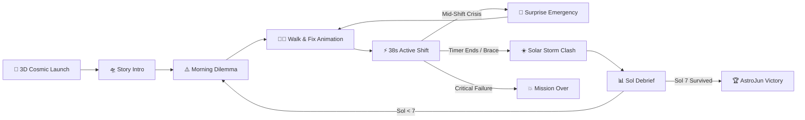

# AstroJun

An interactive 3D Moon & Mars space outpost simulation game. Step into Mission Control, explore rough cratered planetary worlds with hover boots, manage your power grid, resolve real space-physics emergencies, and survive solar storms across 7 Sols.

---

## Key Features

- **3D Cosmic Launch Portal:** Interactive deep-space nebula launch screen featuring clickable 3D Moon and Mars worlds, orbiting mini spacecraft, shooting stars, and a zero-G astronaut.
- **3D Moon & Mars Outposts:** Explore rough, cratered hills and valleys across 5 outpost stations (*Command Bridge*, *Solar Power Yard*, *Air & Water Bay*, *Bio-Dome Greenhouse*, and *Thermal & 3D Print Lab*) with terrain-following catwalks, a slope-tilted rover, and astronaut hover-levitation.
- **3 Game Modes:**
  - **Cadet (Ages 7–9):** Guided 7-Sol space adventure.
  - **Commander (Ages 10–12+):** Higher-stakes 7-Sol survival challenge with selectable Mars landing zones (*Jezero Crater*, *Valles Marineris*, *Arcadia Planitia*).
  - **Sandbox Safe Lab:** Experiment freely with power sliders, test hazards, storms, and radio voices with no game-ending failures.
- **Real Space Physics & Power Allocation:** Balance a shared kilowatt budget across *Water & O2 Electrolysis*, *Hydroponics Grow & Heat*, and *Forcefield Shielding* while tackling regolith dust, vacuum radiator heat, CO2 scrubbers, frozen batteries, and perchlorates.
- **Animated Actions & Storm Clashes:** Every engineering decision and station repair dispatches your astronaut to the fixation site with on-character tools, energy beams, and custom 3D storm/hazard animations.
- **Procedural Space Music, SFX & UHF Radio Audio:** Dynamic Web Audio technical soundtrack with voice ducking, tactile UI/hover sound effects, and Earth Buddy UHF radio speech synthesis.

---

## Tech Stack

- **Frontend:** React 19, TypeScript, Vite, Tailwind CSS v4, Three.js, Lucide React
- **Backend:** Express (`server.ts`) serving Vite middleware in development and static `dist/` in production
- **Space Weather Data:** NASA DONKI Solar Flare API with curated 7-Sol offline archive fallback
- **Audio:** Browser Web Audio API (`AudioContext`)

---

## Getting Started

### Prerequisites
- **Node.js** `>= 20`
- **npm**

### 1. Install Dependencies
```bash
npm install
```

### 2. Configure Environment Variables (Optional)
```bash
cp .env.example .env
```

### 3. Run Development Server
Starts the server and Vite dev middleware on `http://localhost:3000`:
```bash
npm run dev
```

### 4. Lint, Build & Run Production
```bash
npm run lint
npm run build
npm start
```

---

## Project Structure

```text
├── server.ts                          # Express server, API routes & static hosting
├── index.html                         # HTML entry point & fonts
├── public/assets/                     # Cosmic nebula backdrop asset
├── src/
│   ├── App.tsx                        # Main game state loop & phase orchestration
│   ├── index.css                      # Tailwind v4 setup & custom animations
│   ├── components/
│   │   ├── SpaceLandingPage.tsx       # Interactive 3D cosmic launch screen
│   │   ├── Outpost3DViewport.tsx      # 3D Moon/Mars rough terrain & astronaut viewport
│   │   ├── HudTopBar.tsx              # Sol clock, systems telemetry, storm & audio controls
│   │   ├── BottomControlDock.tsx      # Power sliders, station repairs, gadgets & Earth radio
│   │   ├── DilemmaModal.tsx           # Daily engineering dilemma cards
│   │   ├── SurpriseEmergencyModal.tsx # Mid-shift emergency crisis decisions
│   │   ├── DecisionActionOverlay.tsx  # Walk-to-site & action execution banner
│   │   ├── StormImpactOverlay.tsx     # End-of-Sol solar flare clash visualization
│   │   ├── SolDebriefModal.tsx        # End-of-Sol summary & space physics lesson
│   │   ├── StoryCutsceneOverlay.tsx   # Mission intro story slides
│   │   ├── DonkiModal.tsx             # 7-Sol solar storm forecast viewer
│   │   ├── OnboardingModal.tsx        # Quick-start help guide
│   │   └── EndGameModal.tsx           # Victory commendation / mission debrief
│   ├── data/                          # Physics events, station specs & story beats
│   ├── services/                      # NASA DONKI & flight comms services
│   ├── types/game.ts                  # TypeScript types & game interfaces
│   └── utils/                         # Physics simulation, music, SFX, radio & haptics


# 🚀 AstroJun

> **Command a 3D Moon or Mars Outpost · Survive 7 Sols of Real Space Physics**

AstroJun is an interactive 3D planetary survival simulation built with **Three.js**, **React**, and **Web Audio**. Players explore rough, cratered worlds with hover-boot physics, balance a strict kilowatt power grid across life-support systems, repair equipment on-site, and shield the colony against incoming solar storms.

---

## 🌌 Core 7-Sol Gameplay Loop



flowchart TB
    SOLAR["☀️ Solar Power Yard<br/>Generates Grid Budget (kW)"] --> BUS{"⚡ Shared Power Bus"}
    BUS --> AIR["💧 Air & Water Bay<br/>Electrolysis (O₂) + CO₂ Scrubbers"]
    BUS --> BIO["🌱 Bio-Dome Greenhouse<br/>Grow Lights + Thermal Heat"]
    BUS --> CMD["🛰️ Command Bridge<br/>Forcefield Spire + Earth Radio"]
    LAB["🔧 Thermal & 3D Print Lab<br/>Radiators + Spare Valves"] -.->|Prevents Overheat| AIR
    LAB -.->|Supplies Parts| BIO

    pie showData
    title Balanced Storm-Ready Power Split (100 kW)
    "💧 Water & O2 Electrolysis" : 35
    "🌱 Hydroponics & Heating" : 30
    "🛡️ Forcefield Shielding" : 35
