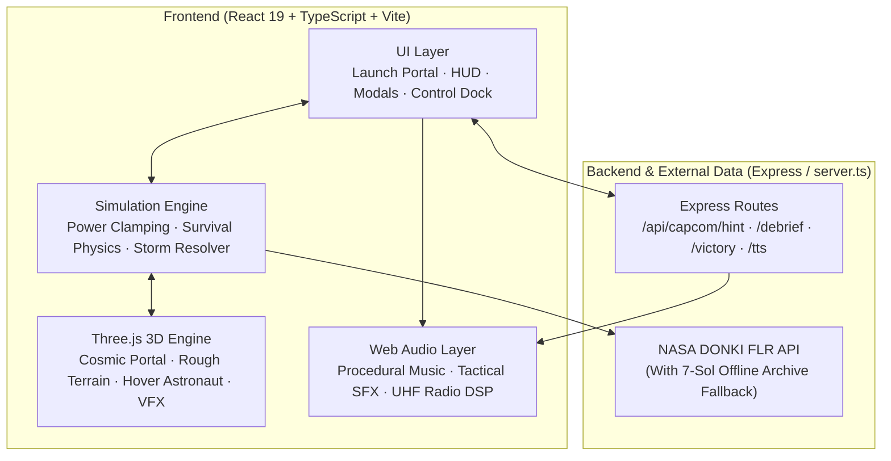
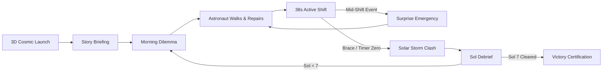

# 🚀 AstroJun

> **Interactive 3D Moon & Mars Outpost Survival Simulation**  
> Built by **Team Code Crushers**

---

## 1. Project Title & Problem Statement

**Project Title:** **AstroJun — 3D Planetary Outpost & Space Physics Simulator**

### Problem Statement
Understanding how astronauts survive off-world involves complex, tightly coupled science concepts—limited solar kilowatt budgets, water-to-oxygen electrolysis, closed-loop hydroponics, cabin thermal dissipation in a vacuum, $\text{CO}_2$ scrubber saturation, toxic Martian perchlorates, and sudden solar radiation storms. Traditional textbooks and static quizzes make these cause-and-effect trade-offs abstract and hard for young learners (ages 7–12+) to grasp intuitively.

**AstroJun** bridges that gap by turning space-habitat engineering into an interactive 3D world where every kilowatt allocation, station repair, and emergency decision has immediate visual, physical, and survival consequences across 7 Sols on the Moon (`0.16g`) and Mars (`0.38g`).

---

## 2. Team Details

**Team Name:** **Code Crushers**

| Member Name | Home Institution | GitHub Username |
| :--- | :--- | :--- |
| **Naman Porte** | YCCE | [@namanporte](https://github.com/namanporte) |
| **Samiksha Chavhan** | YCCE | [@samikshachavhan126-create](https://github.com/samikshachavhan126-create) |
| **Om Kawadkar** | YCCE | [@omkawadkar](https://github.com/omkawadkar) |
| **Shraddha Thakur** | YCCE | [@shradsthakur075-rgb](https://github.com/shradsthakur075-rgb) |
| **Aashna Ramteke** | YCCE | [@aashnaramteke-collab](https://github.com/aashnaramteke-collab) |

---

## 3. Solution Overview & Architecture

### Functional Overview
1. **3D Cosmic Launch Portal:** Players begin in an interactive deep-space nebula scene with clickable 3D Moon and Mars worlds, orbiting craft, zero-G astronaut physics, and mode selection (**Cadet**, **Commander**, or **Sandbox Safe Lab**).
2. **Rough 3D Planetary Outposts:** Players explore cratered, multi-elevation lunar and Martian terrain with hover-levitation boots, terrain-following catwalk ramps, a slope-aligned rover, and five interactive engineering stations (*Command Bridge*, *Solar Power Yard*, *Air & Water Bay*, *Bio-Dome Greenhouse*, and *Thermal & 3D Print Lab*).
3. **7-Sol Simulation Loop:** Each Sol progresses through a **Morning Dilemma**, a **38-second Active Shift** (power allocation, station repairs, backpack gadgets, Earth radio with real `3s`/`8s` light-speed lag, and **Surprise Emergencies**), an end-of-Sol **Solar Storm Clash**, and a **Sol Debrief**.

### System Architecture Diagram



### Gameplay & Power Flow



### Technology Stack

| Layer | Technologies Used |
| :--- | :--- |
| **Frontend Framework** | React 19, TypeScript, Vite, Tailwind CSS v4, Lucide React |
| **3D Graphics & Physics** | Three.js (displaced crater geometry, instanced rocks, custom shader-free PBR materials, raycasting) |
| **Audio & Voice** | Browser Web Audio API (procedural multi-phase soundtrack, SFX synthesizer, UHF bandpass/saturation radio filter, Web Speech fallback) |
| **Backend Server** | Node.js, Express (`server.ts`), `tsx`, `dotenv` |
| **Space Datasets & SDK** | NASA DONKI Solar Flare API, NASA OSDR/Mars Trek profiles, CSA Hydroponics rules, `@google/genai` (optional runtime radio/TTS) |

---

## 4. Installation & Setup Guide

### Prerequisites
- **Node.js** `v20+`
- **npm** `v10+`
- **Git**

### Step-by-Step Local Setup

1. **Clone the repository**
   ```bash
   git clone https://github.com/<your-username>/astrojun.git
   cd astrojun
   ```

2. **Install dependencies**
   ```bash
   npm install
   ```

3. **Configure environment variables (optional)**  
   Copy `.env.example` to `.env`. The simulation runs completely offline with built-in fallbacks even without API keys:
   ```bash
   cp .env.example .env
   ```
   ```env
   PORT=3000
   VITE_NASA_API_KEY=""
   GEMINI_API_KEY=""
   ```

4. **Run the development server**  
   Starts Express + Vite middleware at `http://localhost:3000`:
   ```bash
   npm run dev
   ```

5. **Type-check, build, and run in production**
   ```bash
   npm run lint
   npm run build
   npm start
   ```

---

## 5. AI Usage Disclosure

In accordance with transparent engineering practices, below is an honest breakdown of how AI tools and APIs were used across the project:

1. **Runtime Backend Integration (Optional Dynamic Radio & Voice):**
   - `server.ts` includes optional server-side endpoints (`/api/capcom/hint`, `/api/capcom/debrief`, `/api/capcom/victory`, and `/api/tts`) using the `@google/genai` SDK (`gemini-4-hydrogen` and `gemini-3.8-flash-lite-tts`) to generate contextual Earth Buddy flight-director tips, Sol debrief messages, victory commendations, and spoken audio.
   - `src/services/flightCommsService.ts` and `src/utils/radioVoiceEngine.ts` automatically fall back to deterministic rule-based flight guidance and browser Web Speech synthesis whenever no API key is configured or offline.
2. **Development & Asset Workflow:**
   - AI coding assistance was used during iterative development for refactoring TypeScript components, tuning Three.js 3D terrain math and animation choreography, debugging WebGL/Express payload formats, and drafting documentation structure.
   - Visual illustrations for incident/decision cards in `src/assets/images/` were generated as static project assets, while the core physics simulation (`src/utils/physicsSimulation.ts`), procedural Web Audio soundtrack (`src/utils/musicEngine.ts`), SFX synthesizer (`src/utils/soundEngine.ts`), and 3D terrain/outpost logic (`src/components/Outpost3DViewport.tsx`, `src/components/SpaceLandingPage.tsx`) were engineered explicitly in TypeScript.
3. **Verification:**
   - All physics thresholds, state transitions, TypeScript checks (`npm run lint`), Vite production builds (`npm run build`), and UI behaviors were manually reviewed and verified by the team.
